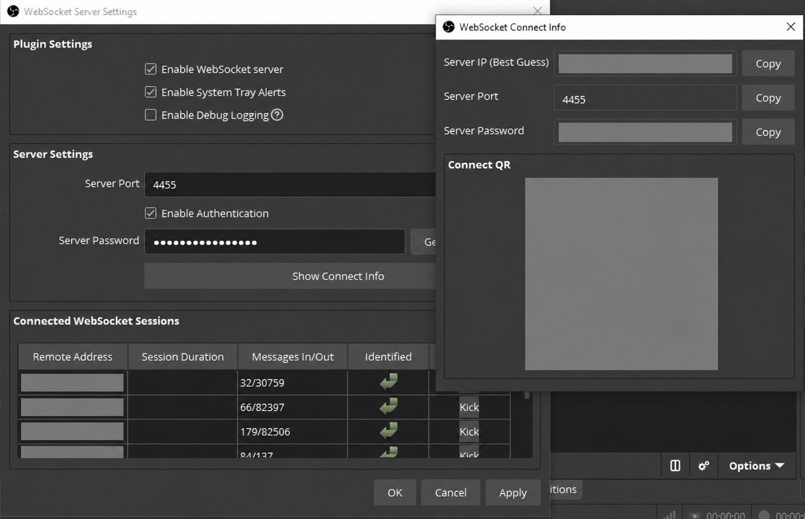

# 4. Enable OBS WebSocket for Remote Control

OBS WebSocket lets other software control OBS. We enable it now so that NOALBS can switch scenes automatically in the next guide, and so an OBS remote-control app can change scenes or start and stop your Twitch/YouTube broadcast while you are away from your streaming computer.

## Enable the WebSocket server

1. In OBS, open **Tools → WebSocket Server Settings**.
2. Enable **WebSocket server**.
3. Set **Server Port** to `4455`. This is OBS's default WebSocket port and is also the port used in our NOALBS example configuration.
4. Leave **Enable Authentication** turned on. Generate or choose a strong password and keep it private.
5. Select **Apply** or **OK** to save the settings.

The password is required by NOALBS and by any remote-control app that connects to OBS. Enter the same password in each app's connection settings. Do not share the password or the connection QR code.

## Connect from another device

The OBS computer must be reachable by the device running your remote-control app:

- On the same computer as OBS, connect to `127.0.0.1` on port `4455`.
- On another computer on your home network, use the OBS computer's internal network IP address and port `4455`.
- When you are away from home, connect to your home network through a trusted VPN, then use the OBS computer's address reachable over that VPN. Moblin's [OBS Remote Control Relay](https://moblin.app/) is another option for remote access.

Do not expose OBS WebSocket directly to the public internet by forwarding port `4455` on your router. WebSocket provides control over OBS, so restrict access to devices and networks you trust. If Windows Firewall blocks local or VPN connections, allow inbound TCP port `4455` only from the trusted network that needs access.

NOALBS normally runs on the OBS computer and connects through `localhost` using port `4455`; the example configuration already uses this port. Continue with [5. Download NOALBS for automatic scene switching](<Download NOALBS for Automatic Scene Switching.md>) or [6. Control OBS remotely from Moblin](<Controlling OBS Remotely from Moblin.md>).
